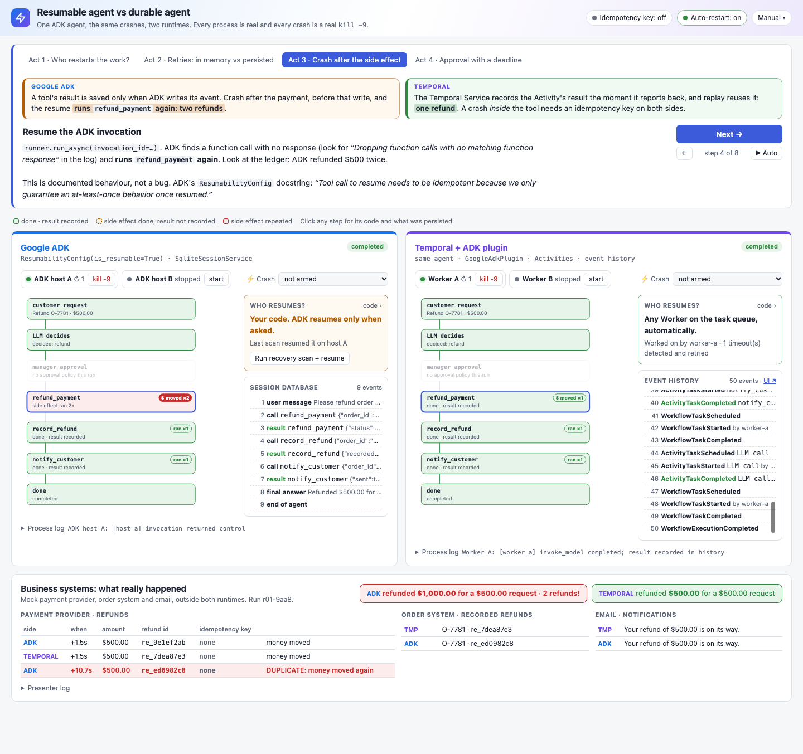
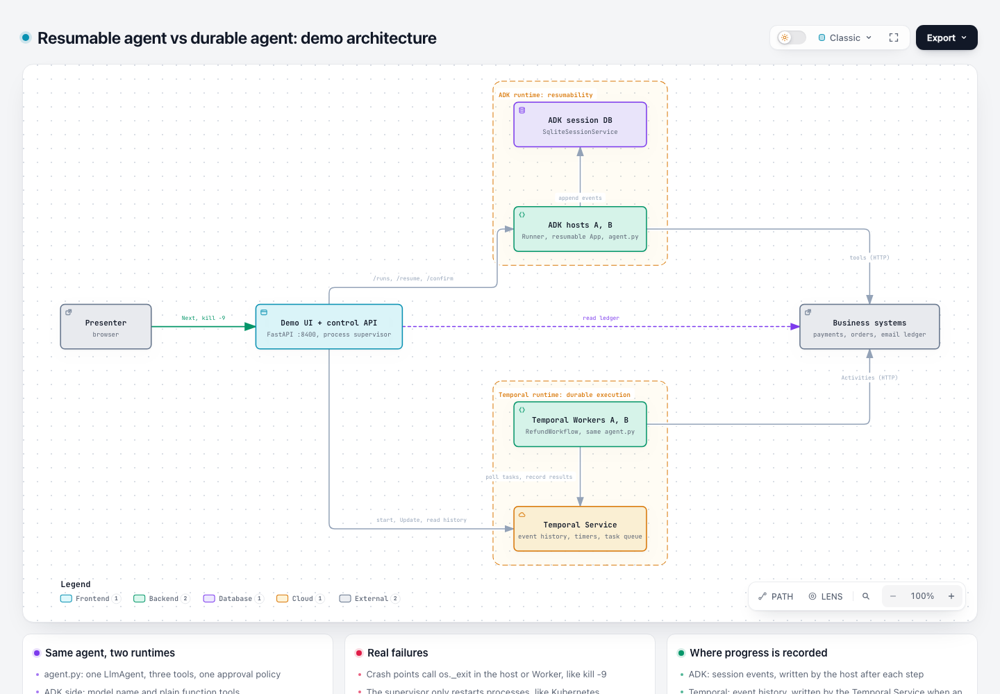
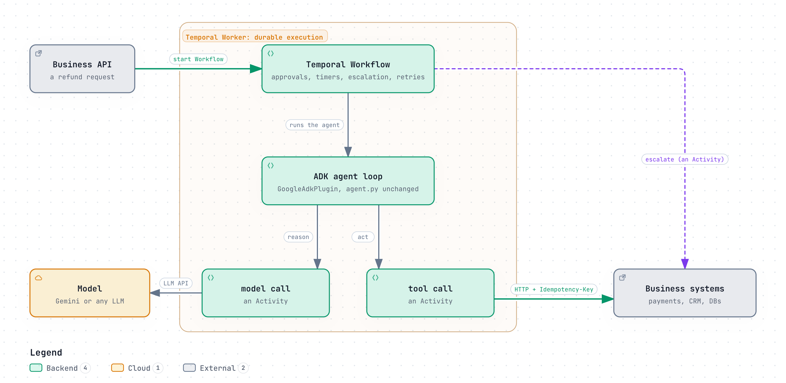

# Resumable agent vs durable agent

[](https://github.com/taonic/temporal-adk-compare/actions/workflows/ci.yml)

Live demo: <https://temporal-adk-compare.fly.dev>. Every visitor gets a private copy of the whole demo, in a [Daytona](https://www.daytona.io) sandbox of their own: crash anything, nobody else is affected.

One Google ADK agent runs on two runtimes side by side, through the same crashes:

- **left:** ADK at full strength, with resumability turned on and a persistent session database;
- **right:** the same `agent.py` inside a Temporal Workflow, through Temporal's official ADK plugin.

Every process is real and every crash is a real `kill -9`. A mock payment provider records how many times the money actually moved.



> [!NOTE]
> This is a demo for an architecture conversation, not a benchmark. ADK's
> resumability is real and the demo uses it properly. The point is where each
> runtime draws the failure boundary, and who restarts the work. Both
> `ResumabilityConfig` (google-adk 2.13.0) and `temporalio-google-adk` (0.0.1)
> are marked experimental.

## Quick start

Requires [uv](https://docs.astral.sh/uv/) and the [Temporal CLI](https://docs.temporal.io/cli).

```bash
make demo        # opens http://localhost:8400
```

`make demo` starts the business systems, ADK host A and Temporal Worker A, and its own Temporal dev server on `localhost:7243` (Web UI on <http://localhost:8243>), with eager Workflow start and eager Activities on: that is how a run stays on Worker A until it crashes. A dev server you already run on 7233 is left alone. Pick a scenario and press **→** (or **Start**) to step through it. Each step runs its actions and shows its talk track as a caption. One column plays at a time: each beat runs on ADK first, then the same refund runs on Temporal.

The agent uses a deterministic fake model by default, so every run takes the same steps. To use Gemini instead:

```bash
GOOGLE_API_KEY=... REFUND_DEMO_MODEL=gemini-2.5-flash make demo
```

The tests and the runbook assume the fake model; a real model may word its tool calls differently.

To run every scenario headless, against real processes, in about two minutes:

```bash
make test
```

The page itself, in a browser: every scenario played through the player, and the player's rules (Next waits for a step's outcome, a new scenario starts on a clean stage, one call to action, the code links open the code, both columns fit one screen):

```bash
uv run --group e2e playwright install chromium   # once
make e2e
```

`make e2e-live` runs the same kind of test against the deployed demo: a new visitor gets a stage of their own on Daytona and plays a scenario through it, and two visitors' stages stay apart. GitHub Actions runs the UI tests in CI before every deploy ([ci.yml](.github/workflows/ci.yml)), and the live tests after every deploy and every day ([e2e.yml](.github/workflows/e2e.yml)).

For presenting, see [RUNBOOK.md](RUNBOOK.md).

## The scenarios

| Scenario | What happens | What it shows | Comparison rows it tests |
|---|---|---|---|
| **1. Recovery: automatic vs on request** | ADK host A and Worker A die before emailing the customer. A spare host and a spare Worker run beside them all along; each run starts on A (on Temporal: an eager start, a sticky queue and eager Activities keep it there). | **Temporal**: once Worker A is gone, the spare Worker, already polling, picks the refund up from the task queue, with no one calling anything. **ADK**: the spare host sits idle next to an unfinished invocation, until someone runs the recovery code. | Resume after process crash · Distributing work across hosts |
| **2. Retries: durable vs in memory** | Every model call fails with a 429; both sides retry on the same schedule (1s, doubling, capped at 4s). Then each side's process is killed mid-retry. | Until the kill, the same. **ADK** retries in process (`retry_options`, as on `Gemini`): the retry loop dies with the host, and the invocation stays unfinished until the recovery scan resumes it. **Temporal** keeps the attempt count and the next retry time on the Temporal Server: the restarted Worker carries on with the next attempt and finishes by itself once the model is back. | Retries · Resume after process crash |
| **3. Tool results: recorded on completion vs saved later** | Each side's process dies right after `refund_payment` returns, before the result is recorded. | **ADK refunds twice** once resumed: the money moved but the session database never got the result. **Temporal refunds once**: the Temporal Server recorded the Activity's result the moment it reported back, and replay reuses it. Then, with a crash *inside* the tool, **both** refund twice, until an idempotency key makes both safe. | Avoid repeating completed steps · External tool side effects · Resume after process crash |
| **4. Timers: durable vs in memory** | Refunds over $250 need a manager within 48h (20s in the demo). Both sides enforce the deadline: ADK's host with an `asyncio` timer, Temporal with a durable timer. Every process is stopped during the wait. | Both pause the same way, with ADK's own tool confirmation. **Temporal**'s timer fires on the Temporal Server with no Worker running, then the next Worker escalates and denies. **ADK**'s timer was in the stopped host's memory: the invocation stays paused past the deadline, still resumable by a late approval. With every process up, both deadlines fire (the tests check both). | Durable timers · Human-in-the-loop · Long-running business processes |

The **Wrap-up** is content only, in four slides: the four results in one table (durable execution takes care of automated process recovery, durable retries, strongly consistent tool execution and durable timers; the resumable agent leaves each to your code or to process memory), the full capability comparison, the recommended architecture, and the questions to ask any agent runtime.

`tests/test_acts.py` pins each of these outcomes, so they can be reproduced rather than taken on trust. CI runs them on every push.

## How it works

[](doc/architecture.html)

Interactive versions: [plain ADK](doc/adk-runtime.html) and [Temporal + ADK](doc/temporal-runtime.html) (the demo's Overview page), [architecture](doc/architecture.html), [ADK crash sequence](doc/crash-adk.html), [Temporal crash sequence](doc/crash-temporal.html). Each is generated by [archify](https://github.com/tt-a1i/archify) from the `.archify.json` next to it.

| Path | What it is |
|---|---|
| [refund_demo/agent.py](refund_demo/agent.py) | **The agent both sides run.** One `LlmAgent`, three tools, an approval policy via `FunctionTool(require_confirmation=...)`. Each runtime passes in only its model and tool adapter. |
| [refund_demo/tools.py](refund_demo/tools.py) | `refund_payment`, `record_refund`, `notify_customer`: HTTP calls to the business systems. Plain ADK function tools, with no Temporal import. |
| [refund_demo/temporal_side/activities.py](refund_demo/temporal_side/activities.py) | A thin Activity around each tool, so Temporal can run it: `@activity.defn` and the plugin's serializable `ToolContextSnapshot`. Plus `escalate_to_manager`, the Workflow's own business step. |
| [refund_demo/adk_side/host.py](refund_demo/adk_side/host.py) | ADK side: a small agent host (like `adk api_server`) with `App(resumability_config=ResumabilityConfig(is_resumable=True))` and `SqliteSessionService`. |
| [refund_demo/adk_side/recovery.py](refund_demo/adk_side/recovery.py) | The recovery code you write yourself on ADK: scan sessions for unfinished invocations. |
| [refund_demo/temporal_side/workflow.py](refund_demo/temporal_side/workflow.py) | Temporal side: the agent inside `RefundWorkflow`, with `TemporalModel` and `activity_as_tool`; the approval deadline (`wait_condition` with a timeout) and escalation. |
| [refund_demo/temporal_side/worker.py](refund_demo/temporal_side/worker.py) | A Worker with `GoogleAdkPlugin`. Start any number; any of them can continue any refund. |
| [refund_demo/faults.py](refund_demo/faults.py) | Crash points: `os._exit` at an exact place, armed per side, consumed once. |
| [refund_demo/business/service.py](refund_demo/business/service.py) | Mock payment provider, order system and email, honouring `Idempotency-Key`. The ground truth. |
| [refund_demo/api.py](refund_demo/api.py), [procs.py](refund_demo/procs.py) | Control plane: starts and kills processes (optionally restarting them, like Kubernetes), and reads all three sources of truth for the UI. |
| [refund_demo/static/](refund_demo/static/) | The UI: one HTML page, no build step. [scenarios.json](refund_demo/static/scenarios.json) holds the scenarios and their captions. |
| [refund_demo/source_view.py](refund_demo/source_view.py) | Serves the code behind each diagram node, read from the running modules with `inspect`. |

Click any step in either diagram for two tabs: **Code**, the real source behind that step, and **What's persisted**, the session events or history events recorded for it in this run, next to how many times the side effect really happened.

### Same agent, two runtimes

```python
# ADK side (adk_side/host.py)
build_agent(model=config.MODEL,
            refund_payment=tools.refund_payment, ...)

# Temporal side (temporal_side/workflow.py)
build_agent(model=TemporalModel(config.MODEL, ...),
            refund_payment=activity_as_tool(activities.refund_payment, **TOOL_OPTIONS), ...)

# temporal_side/activities.py: a thin Activity around the same tool
@activity.defn
async def refund_payment(order_id: str, amount_cents: int, reason: str,
                         tool_context: ToolContextSnapshot) -> dict:
    return await tools.refund_payment(order_id, amount_cents, reason, tool_context)
```

`tools.py` has no Temporal in it. The Activity exists because a tool that runs on another process can't take ADK's live `ToolContext`; the plugin passes a serializable snapshot with the same `state` and `function_call_id`.

The Temporal plugin runs the ADK agent loop inside the Workflow, with **one Activity per model call and per tool call**. A crash therefore costs at most the one call that was in flight. If the whole agent ran inside a single Activity instead, a crash would re-run the agent from the start, including the model's decision.

## ADK resumability vs Temporal durable execution

ADK and Temporal provide durability at different layers. ADK asks: *how can an agent keep its context and resume?* Temporal asks: *how can a whole business process survive failures without losing progress or repeating completed work?* The two overlap, but they are not the same.

### Where the failure boundary is

ADK writes an event to the session database after each step of the agent. A tool's result exists only once its function-response event has been written. If the process dies between the tool returning and that write, the side effect has happened and the session has no record of it. On resume, ADK drops the call that has no response and runs the tool again. ADK documents this in `ResumabilityConfig`:

> ADK resumes the invocation in a best-effort manner:
> 1. Tool call to resume needs to be idempotent because we only guarantee an at-least-once behavior once resumed.
> 2. Any temporary / in-memory state will be lost upon resumption.
>
> (`google/adk/apps/_configs.py`, google-adk 2.13.0)

On Temporal, a tool call is an Activity. The **Temporal Server** records its result as soon as the Activity reports back, before any Workflow code runs. A crash after that point can't lose the result, and replay returns it without running the tool again. A crash *inside* the Activity, before it reports back, means a retry after the Activity's timeout. **Neither runtime makes an external side effect exactly-once by itself.** Scenario 3 shows both refunding twice in that case, and an idempotency key fixing both. What Temporal changes is where the window is (inside the Activity only), who handles the retry, and how (declared per Activity, every attempt in the history).

The key in this demo is `<run id>:<function call id>`. Both runtimes keep the function call id stable: Temporal retries with the arguments recorded in the history, and ADK resumes with the function call it persisted (`tests/test_acts.py` checks that the key deduplicates on both). In production, prefer a key derived from the business operation, such as the refund request's id.

Two more places where ADK's boundary sits. The scenarios don't stage them, but `tests/test_acts.py` reproduces both:

- **Parallel tool calls are saved together.** When the model asks for several tools in one turn, ADK runs them concurrently and writes all their results as one event, once every call has returned (`google/adk/flows/llm_flows/tools/_batch_executor.py`). If a call raises, ADK keeps its siblings' finished results; if the process dies, none are saved, and a resume runs every call in the turn again, including those that had finished. The Temporal plugin runs each call as its own Activity, so each result is recorded as it completes.
- **Concurrent resumes are caught after the fact.** The persistent session services check for a conflicting writer when an event is appended (`append_event` raises `StaleSessionError`). A tool runs before its result is appended, so two hosts resuming one invocation both run the tool, and only then does one of them fail. Preventing that takes a lease in your recovery code. On Temporal, the Server hands a task to one Worker at a time.

### Capability comparison

| Capability | Google ADK | Temporal | In the demo |
|---|---|---|---|
| Persistent agent state | Session events in a session service | Workflow event history | Both columns' "What's persisted" |
| Resume after a process crash | Yes, when something calls `run_async(invocation_id=...)` | Automatic: any Worker polling the task queue | Scenarios 1, 2 and 3 |
| Avoid repeating completed steps | For steps whose result event was written; parallel calls in one turn are written together, after the last returns | For Activities whose completion was recorded, each on its own | Scenario 3 |
| Retries | Per node in ADK graph workflows; in-process `retry_options` on the Gemini model (off by default); varies by runtime | Per Activity, for model calls and tools alike: timeout, backoff, attempts, across restarts | Scenario 2; Scenario 3 (`attempt 2`) |
| Durable timers | In-process timers you write; durable ones need a scheduler you add | Native, on the Temporal Server | Scenario 4 |
| Human-in-the-loop | Native: tool confirmation, long-running tools | Native: Signals, Updates, durable waits | Scenario 4 (both use ADK's tool confirmation) |
| External side effects | At-least-once on resume, once per resuming host; needs idempotency | At-least-once inside an Activity; needs idempotency | Scenario 3 |
| Distributing work across hosts | Deployment-dependent; leases are yours to add | Task queues and Workers; one Worker per task at a time | Scenario 1 |
| Orchestrating more than the agent | Agent-oriented | General-purpose: escalations, payments, any code | Scenario 4 (`escalate_to_manager`) |

ADK is moving fast: graph workflows with node retry policies and human-in-the-loop handling in ADK 2.x, and Google's separately announced [Agent Executor](https://cloud.google.com/blog/products/ai-machine-learning/agent-executor-googles-distributed-agent-runtime) runtime, which targets resuming execution after outages. The useful question is not whether ADK is durable, but how much reliability comes from the agent framework and how much from the runtime around it. Agent Executor is a managed Google Cloud runtime and is not part of this local demo.

### Recommended architecture

<picture>
  <source srcset="doc/recommended-dark.png" media="(prefers-color-scheme: dark)">
  
</picture>

[Interactive version](doc/recommended.html), generated by archify from [doc/recommended.archify.json](doc/recommended.archify.json).

Temporal owns the lifecycle of the business process; ADK owns the agent's reasoning and tool selection. This is the right-hand column of the demo.

| Use case | Recommended approach |
|---|---|
| Conversational assistant with tool calling | ADK alone |
| Long-running agent with resumable reasoning | ADK resumability, or a managed agent runtime |
| Critical business process with agents, payments, approvals and external systems | Temporal + ADK |

### Questions worth asking any agent runtime

1. **Crash consistency.** A tool performs an external side effect, then the process dies before the checkpoint is written. What happens? And when the model made several tool calls in one turn and some had finished? *(Scenario 3; the parallel case is in the tests.)*
2. **Recovery ownership.** After a host dies, or a model call fails, what schedules the recovery? Does the application call resume itself? And where does a retry's state live while it backs off? *(Scenarios 1 and 2.)*
3. **Concurrent recovery.** What stops two replicas from resuming the same execution at once? *(Not staged; see the tests.)*
4. **Durable waiting.** Can an agent wait 30 days for an event, without holding compute or relying on a custom scheduler, and act when a deadline passes? *(Scenario 4.)*
5. **Execution guarantees.** Which operations are replayed, which are retried, and which are guaranteed not to repeat after a recorded completion?
6. **Versioning.** What happens to a three-week execution when the agent's graph, prompts or tools change?
7. **Integrity of what gets re-run.** Who can change a stored tool call's arguments before a resume runs it?

### More differences, not on stage

- **In-memory state.** ADK's docstring above: *"Any temporary / in-memory state will be lost upon resumption."* ADK restores what is in session events and session state. Temporal replays the Workflow code itself, so its local variables come back too. On ADK, keep anything a resume needs (a per-invocation limit, a running total) in session state.
- **Code changes between crash and resume.** Temporal replays history against the new code and raises a non-determinism error if they disagree, so Workflow-side changes need patching or Worker Versioning. That is stricter, and more work. ADK resumes against whatever code the resuming host runs, with no check that it matches what produced the stored events.
- **Who can change what will run again.** On resume, ADK runs stored function calls with their stored arguments. ADK ships `ToolCallIntegrityPlugin` (`google/adk/plugins/_tool_call_integrity_plugin.py`) because anyone who can write to the session store could change those arguments first; it signs each call with an HMAC. Temporal's history is append-only through the Server API, and Activity inputs are recorded when the Activity is scheduled. A security review of either should cover who has write access to the underlying store.

**In one line:** ADK helps an agent continue its work after an interruption. Temporal helps the whole business transaction continue reliably, even when the agent, its tools or the infrastructure fail. They are complementary.

## Configuration

| Variable | Default | |
|---|---|---|
| `REFUND_DEMO_MODEL` | `demo-refund-model` | The fake model; any ADK model name, e.g. `gemini-2.5-flash` |
| `FAKE_LLM_DELAY`, `BUSINESS_DELAY` | `0.8`, `0.5` | Seconds per model call / business call, so each step is visible |
| `RESTART_DELAY` | `2` | Seconds before the supervisor restarts a dead process |
| `TEMPORAL_ADDRESS`, `TEMPORAL_UI` | `localhost:7233`, `http://localhost:8233` | Temporal Server and its Web UI |
| `API_PORT`, `BUSINESS_PORT`, `ADK_HOST_A_PORT`, `ADK_HOST_B_PORT` | `8400`, `8420`, `8411`, `8412` | |
| `API_HOST` | `127.0.0.1` | Address the UI and API listen on (`0.0.0.0` in the container) |
| `TEMPORAL_UI_IP` | (unset) | Address the dev server binds its Web UI to, when the API starts one (`0.0.0.0` in the container) |

## Deployment

Two GitHub Actions workflows:

- [ci.yml](.github/workflows/ci.yml) runs the unit and scenario tests (real processes, a real Temporal dev server) and builds both container images, on every push and pull request.
- [deploy.yml](.github/workflows/deploy.yml) deploys `main` once CI has passed on it: it builds the visitors' sandbox snapshot on Daytona if its inputs changed, then deploys the front door to Fly.io with `flyctl deploy --remote-only --ha=false`. It needs the repository secrets `FLY_API_TOKEN` (`fly tokens create deploy`) and `DAYTONA_API_KEY`, and the Fly secret `DAYTONA_API_KEY` (`fly secrets set DAYTONA_API_KEY=...`).

The live demo gives every visitor a stage of their own, so nobody's crash or reset reaches anyone else:

- **The front door** ([frontdoor/](frontdoor/), on Fly.io) gives each visitor a cookie and a [Daytona](https://www.daytona.io) sandbox, found again by its labels, and proxies the visitor's requests to it: the demo on the usual port, the Temporal UI on port 8233. While the stage starts (about 15 seconds the first time), it shows a waiting page. It caps how many stages run at once (`MAX_SANDBOXES` in [fly.toml](fly.toml)). Only a person's browser starts a stage: loading a page starts nothing, the waiting page's script asks for it with the visitor's cookie and a header of its own, bots and headless browsers are turned away, `robots.txt` keeps crawlers off `/_stage/`, and each IP starts at most `STARTS_PER_IP_PER_HOUR` stages (10 by default). [tests/test_frontdoor.py](tests/test_frontdoor.py) pins this.
- **Each sandbox** is created from a snapshot of the demo's dependencies ([frontdoor/sandbox.Dockerfile](frontdoor/sandbox.Dockerfile), built by `python -m frontdoor.snapshot`, named after a hash of its inputs). The front door uploads the current `refund_demo/` into it and runs `python -m refund_demo.api`, exactly as `make demo` does. A sandbox stops after 15 idle minutes and is deleted a day later; the next visit wakes it.

To run the front door locally against Daytona: `DAYTONA_API_KEY=... uv run --group frontdoor python -m frontdoor`, then open <http://localhost:8080>.

The [Dockerfile](Dockerfile) still runs the whole demo in one container, exactly as `make demo` does, for anyone who wants it in Docker.

## Limits

- The fake model makes the runs repeatable. It plays the role of a model following `INSTRUCTION`, not of model reasoning.
- The ADK host is a minimal FastAPI wrapper around `Runner`, standing in for `adk api_server` or a managed runtime. With a managed runtime, the recovery and deadline gaps in Scenarios 1 and 4 are that runtime's responsibility; ask how it handles them.
- The model outage (Scenario 2) is simulated by the fake model, which honours `retry_options` the way `Gemini` does (attempts and exponential backoff, without jitter). With `REFUND_DEMO_MODEL` set to a Gemini model, the ADK side passes the same `retry_options` to `Gemini`.
- Fault injection uses ADK's `before_tool_callback` / `after_tool_callback`, and calls inside `refund_payment`. On the Temporal side the callbacks run in Workflow code, where `faults.py` steps outside the sandbox and never fires during replay.
- No authentication anywhere. The public deployment is open: anyone with the URL can start runs, kill processes and reset, and every viewer shares the same demo. Machines stop when idle and start on the next request, from a clean state.
